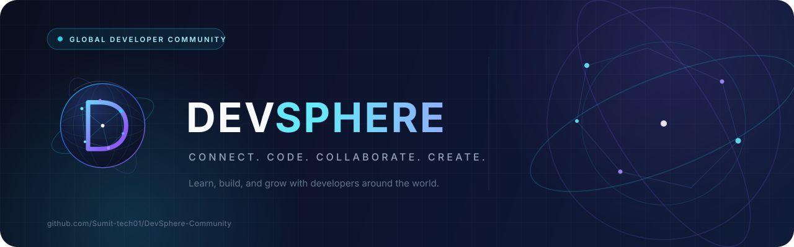

<p align="center">
  <a href="https://github.com/Sumit-tech01/DevSphere-Community">
    
  </a>
</p>

<h1 align="center">DevSphere</h1>

<p align="center">
  <strong>Connect. Code. Collaborate. Create.</strong><br>
  A free, GitHub-native community for developers who learn by building together.
</p>

<p align="center">
  <a href="https://github.com/Sumit-tech01/DevSphere-Community/discussions">
    
  </a>
  <a href="resources/README.md">
    
  </a>
  <a href="resources/learning-roadmaps.md">
    
  </a>
  <a href="LICENSE">
    
  </a>
  <a href="CONTRIBUTING.md">
    
  </a>
</p>

<p align="center">
  <a href="#community-introduction">Introduction</a> ·
  <a href="#join-the-community">Join</a> ·
  <a href="#developer-resource-hub">Resources</a> ·
  <a href="#learning-roadmaps">Roadmaps</a> ·
  <a href="#project-showcase">Showcase</a> ·
  <a href="#developer-spotlight">Spotlight</a> ·
  <a href="#community-discussions">Discussions</a> ·
  <a href="#contribution-guidelines">Contribute</a>
</p>

<p align="center">
  <strong><a href="https://github.com/Sumit-tech01/DevSphere-Community/discussions">Join the community →</a></strong>
</p>

---

## Community Introduction

DevSphere is a free community for developers at every stage: people writing their first program, people changing roles, and people maintaining projects used by others. It is built on GitHub Discussions, where conversations stay searchable and contributions stay connected to the work.

The community launched in **November 2026** and is being built in public. There are no paid memberships, no hidden sign-up funnel, and no claims of partnerships, funding, or achievements that cannot be verified. The goal is simpler: make useful learning paths, honest resources, and real collaboration easier to find.

| What you can do here | Where it happens |
| --- | --- |
| Follow a structured learning path | [Learning Roadmaps](#learning-roadmaps) |
| Use curated, reviewed resources | [Developer Resource Hub](#developer-resource-hub) |
| Ask a technical question | [Questions & Help](https://github.com/Sumit-tech01/DevSphere-Community/discussions/categories/questions-help) |
| Share a project and get feedback | [Project Showcase](https://github.com/Sumit-tech01/DevSphere-Community/discussions/categories/project-showcase) |
| Find collaborators | [Collaboration](https://github.com/Sumit-tech01/DevSphere-Community/discussions/categories/collaboration) |
| Practice open source | [Open-Source Hub](#open-source-hub) |
| Prepare for opportunities | [Career & Opportunities](https://github.com/Sumit-tech01/DevSphere-Community/discussions/categories/career-opportunities) |

**What DevSphere is:** a learning and collaboration hub maintained in public, with free resources, templates, and community discussions.

**What it is not:** a bootcamp, a job guarantee, a paid course, a recruiting agency, or a replacement for official documentation. Read the [Community Guidelines](community/COMMUNITY_GUIDELINES.md) and [Code of Conduct](CODE_OF_CONDUCT.md) before participating.

---

## Join the Community

There is no separate registration form. Participation happens in GitHub Discussions, and your GitHub account is your community identity.

1. **Open [DevSphere Discussions](https://github.com/Sumit-tech01/DevSphere-Community/discussions).**
2. **Introduce yourself** in [Introductions](https://github.com/Sumit-tech01/DevSphere-Community/discussions/categories/introductions). Share what you are learning and what you want to build.
3. **Choose one category** from the [category map](#community-discussions) and read a few threads before posting.
4. **Make one useful move:** ask a specific question, answer someone, share a project, or review a resource.

> **New here?** Start with the [Discussion Guide](community/DISCUSSION_GUIDE.md) for posting etiquette, category guidance, and a first-week checklist.

The community is free to participate in. Be respectful, avoid spam and self-promotion, and never share credentials or private data.

---

## Why Join DevSphere?

| Reason | What it looks like |
| --- | --- |
| **Learn with structure** | Ten role-based roadmaps with concepts, official resources, projects, and milestones |
| **Use resources you can trust** | Curated collections with official links, honest status labels, and no affiliate placements |
| **Build in public** | Showcase projects, document trade-offs, and get specific feedback |
| **Find collaborators** | Propose projects, request a teammate, or ask for a focused code review |
| **Practice open source** | Learn the contribution workflow with templates and community support |
| **Prepare for opportunities** | Explore portfolios, resumes, interviews, and verified external programs without hype |
| **Grow with the community** | Help shape resources, activities, and discussions as the community develops |

DevSphere does not promise jobs, internships, funding, followers, or viral reach. It offers a place to do the work, ask better questions, and meet people who care about the craft.

---

## Developer Resource Hub

The collections are free to browse, and every entry points to official documentation, recognized open-source projects, or stable educational references. Paid resources are labeled only when they are relevant, and they are never required for the free path.

| Collection | Best for | What is inside |
| --- | --- | --- |
| [Learning Roadmaps](resources/learning-roadmaps.md) | Choosing a direction | Ten role-based paths with projects and milestones |
| [Programming](resources/programming.md) | Learning languages and fundamentals | Python, JavaScript, TypeScript, Go, Rust, C++, Java, computer science |
| [Web Development](resources/web-development.md) | Building for the web | HTML, CSS, React, Next.js, Node.js, databases, APIs, accessibility |
| [App Development](resources/app-development.md) | Building mobile apps | Android, iOS, Flutter, React Native, Expo, testing, release |
| [AI & Machine Learning](resources/artificial-intelligence.md) | Understanding and building AI systems | ML foundations, deep learning, LLMs, AI applications, evaluation, responsible AI |
| [Developer Tools & APIs](resources/developer-tools.md) | Working efficiently | Git, GitHub, VS Code, Docker, Postman, Figma, Linux, cloud, API design |
| [Open Source](resources/open-source.md) | Contributing to projects | Git, GitHub, licensing, first contributions, maintainability, security |
| [Career Development](resources/career-development.md) | Presenting your work | Portfolios, resumes, interviews, DSA, internships, job-search safety |

<details>
<summary><strong>Featured free starting points</strong></summary>

| Resource | Best for | Level |
| --- | --- | --- |
| [MDN — Learn Web Development](https://developer.mozilla.org/en-US/docs/Learn_web_development) | HTML, CSS, JavaScript, and the web platform | Beginner |
| [The Python Tutorial](https://docs.python.org/3/tutorial/) | Python fundamentals from the official source | Beginner |
| [React — Learn](https://react.dev/learn) | Components, state, and modern React | Beginner–Intermediate |
| [PostgreSQL Tutorial](https://www.postgresql.org/docs/current/tutorial.html) | Relational databases and SQL | Beginner |
| [Google — Machine Learning Crash Course](https://developers.google.com/machine-learning/crash-course) | Practical ML foundations | Beginner |
| [Hugging Face — Learn](https://huggingface.co/learn) | LLMs, agents, and modern AI | Beginner–Intermediate |
| [Pro Git](https://git-scm.com/book/en/v2) | Version control from the ground up | Beginner–Advanced |
| [Docker — Get Started](https://docs.docker.com/get-started/) | Containers and reproducible environments | Beginner |

</details>

**Status labels in the collection:** `Free`, `Free + paid`, `Paid`, `Docs free; usage billed`, and `Free student resources`. DevSphere does not sell listings or accept affiliate links. If a link is broken or a status is wrong, use the [resource submission process](community/RESOURCE_SUBMISSION.md).

---

## Learning Roadmaps

The roadmaps are sequences, not schedules. Move on when you can explain and apply a concept, build the suggested projects, and gather evidence of your progress. No roadmap guarantees employment or a specific salary.

| Roadmap | Focus | Start |
| --- | --- | --- |
| **Frontend Developer** | Accessible, responsive interfaces | [Open roadmap](resources/learning-roadmaps.md#frontend-developer) |
| **Backend Developer** | APIs, data, security, reliability | [Open roadmap](resources/learning-roadmaps.md#backend-developer) |
| **Full-Stack Developer** | End-to-end product delivery | [Open roadmap](resources/learning-roadmaps.md#full-stack-developer) |
| **AI Engineer** | LLM applications, retrieval, evaluation | [Open roadmap](resources/learning-roadmaps.md#ai-engineer) |
| **ML Engineer** | Training, deploying, and operating models | [Open roadmap](resources/learning-roadmaps.md#machine-learning-engineer) |
| **Data Scientist** | Statistics, analysis, experiments, communication | [Open roadmap](resources/learning-roadmaps.md#data-scientist) |
| **Python Developer** | Readable, tested Python for real tools | [Open roadmap](resources/learning-roadmaps.md#python-developer) |
| **Mobile App Developer** | Android, iOS, Flutter, React Native | [Open roadmap](resources/learning-roadmaps.md#mobile-app-developer) |
| **DevOps Engineer** | Linux, containers, CI/CD, cloud, operations | [Open roadmap](resources/learning-roadmaps.md#devops-engineer) |
| **Open-Source Contributor** | Useful contributions and maintainership | [Open roadmap](resources/learning-roadmaps.md#open-source-contributor) |

Each roadmap includes a learning sequence, core concepts, official resources, project ideas, milestones, and a link to the matching discussion category. Use the [full roadmap guide](resources/learning-roadmaps.md) to compare paths or choose between similar roles.

---

## AI & Machine Learning Hub

Start with foundations, then move toward the part of AI you actually want to build: classical ML, deep learning, LLM applications, evaluation, or responsible deployment.

| Resource | Use it for | Level |
| --- | --- | --- |
| [Google — Machine Learning Crash Course](https://developers.google.com/machine-learning/crash-course) | Practical ML foundations with exercises | Beginner |
| [Microsoft — AI for Beginners](https://github.com/microsoft/AI-For-Beginners) | A broad, structured AI curriculum | Beginner |
| [Hugging Face — Learn](https://huggingface.co/learn) | LLMs, agents, diffusion, and hands-on courses | Beginner–Intermediate |
| [PyTorch — Learn the Basics](https://docs.pytorch.org/tutorials/beginner/basics/intro.html) | Tensors, autograd, and training loops | Beginner |
| [OpenAI — API Documentation](https://developers.openai.com/api/docs) | Building with model APIs and structured outputs | Intermediate |
| [NIST AI Risk Management Framework](https://www.nist.gov/itl/ai-risk-management-framework) | Risk, governance, and responsible deployment | Intermediate |

**Build sequence:** Python and data → ML foundations → one domain (NLP, vision, or tabular) → evaluation → retrieval and tools → deployment, cost, and safety. The [AI Engineer roadmap](resources/learning-roadmaps.md#ai-engineer) turns that into projects and milestones.

Explore the full [AI & Machine Learning collection](resources/artificial-intelligence.md), including AI application development, evaluation, research, and responsible AI. Discuss it in [AI & Machine Learning](https://github.com/Sumit-tech01/DevSphere-Community/discussions/categories/ai-machine-learning).

---

## Web & App Development

### Web development

| Resource | Use it for |
| --- | --- |
| [MDN — Learn Web Development](https://developer.mozilla.org/en-US/docs/Learn_web_development) | The web platform, from HTML to APIs |
| [React — Learn](https://react.dev/learn) | Components, state, and modern React |
| [Next.js — Learn](https://nextjs.org/learn) | Routing, rendering, data fetching, and deployment |
| [Node.js — Learn](https://nodejs.org/learn) | Server-side JavaScript and APIs |
| [PostgreSQL Tutorial](https://www.postgresql.org/docs/current/tutorial.html) | Relational data and SQL |
| [OpenAPI Specification](https://spec.openapis.org/oas/latest.html) | Contract-first API design |

Follow the [Frontend](resources/learning-roadmaps.md#frontend-developer), [Backend](resources/learning-roadmaps.md#backend-developer), or [Full-Stack](resources/learning-roadmaps.md#full-stack-developer) roadmap. Ask in [Web Development](https://github.com/Sumit-tech01/DevSphere-Community/discussions/categories/web-development) and use the [web collection](resources/web-development.md) for the full list.

### App development

| Resource | Use it for |
| --- | --- |
| [Flutter Documentation](https://docs.flutter.dev/) | Cross-platform apps with Dart |
| [React Native Documentation](https://reactnative.dev/docs/getting-started) | Native mobile apps with React |
| [Expo Documentation](https://docs.expo.dev/) | A managed React Native workflow |
| [Android Get Started](https://developer.android.com/get-started) | Native Android with Kotlin and Compose |
| [SwiftUI Tutorials](https://developer.apple.com/tutorials/swiftui) | Native Apple interfaces |
| [Apple Human Interface Guidelines](https://developer.apple.com/design/human-interface-guidelines/) | Platform interaction and visual guidance |

Follow the [Mobile App Developer roadmap](resources/learning-roadmaps.md#mobile-app-developer), use the [app collection](resources/app-development.md), and ask in [App Development](https://github.com/Sumit-tech01/DevSphere-Community/discussions/categories/app-development).

**Choose one path and finish one small app.** The goal is a working, tested, documented product — not five unfinished starters.

---

## Developer Tools & APIs

| Tool | Use it for | Start here |
| --- | --- | --- |
| **Git** | Version control and safe branching | [Pro Git](https://git-scm.com/book/en/v2) |
| **GitHub** | Repositories, reviews, issues, and automation | [GitHub documentation](https://docs.github.com/en) |
| **VS Code** | Editing, debugging, and extensions | [VS Code documentation](https://code.visualstudio.com/docs) |
| **Docker** | Reproducible containers and local services | [Docker — Get started](https://docs.docker.com/get-started/) |
| **Postman** | Exploring and testing HTTP APIs | [Postman learning center](https://learning.postman.com/docs/getting-started/overview/) |
| **Figma** | Interface design and collaboration | [Figma help center](https://help.figma.com/hc/en-us) |
| **Linux** | Shell, servers, and automation | [The Missing Semester](https://missing.csail.mit.edu/) |
| **OpenAPI** | Describing APIs as a contract | [OpenAPI specification](https://spec.openapis.org/oas/latest.html) |

The [Developer Tools & APIs collection](resources/developer-tools.md) covers Git, editors, containers, API testing, design, Linux, cloud platforms, and open-source utilities. Cloud documentation is free; creating cloud resources may cost money. Always check current pricing and billing before deploying.

Ask tooling questions in [Programming](https://github.com/Sumit-tech01/DevSphere-Community/discussions/categories/programming). Never post tokens, private keys, or cloud credentials.

---

## Open-Source Hub

Open source is a collaboration model, not free labor. Start small, read the project's rules, and communicate before making a large change.

1. **Learn the Git workflow.** Fork, clone, branch, commit, and push.
2. **Choose a project you use.** Read its README, contribution guide, license, and code of conduct.
3. **Find a bounded issue.** Documentation, tests, and reproducible bugs are good first contributions.
4. **Confirm the approach.** Comment on the issue before significant work.
5. **Open a focused pull request.** Explain the problem, the change, and how you verified it.
6. **Respond to review with evidence and patience.** A pull request is a proposal, not a guarantee of merge.

| Resource | Why it helps |
| --- | --- |
| [DevSphere Open-Source Guide](community/OPEN_SOURCE_GUIDE.md) | The full workflow, communication, and review path |
| [Open Source Resources](resources/open-source.md) | Curated Git, licensing, security, and maintainership links |
| [First Contributions](https://firstcontributions.github.io/) | Practice the fork and pull request workflow |
| [Good First Issue](https://goodfirstissue.dev/) | Find beginner-friendly issues |
| [Open Source Guides — How to Contribute](https://opensource.guide/how-to-contribute/) | A complete contribution guide |
| [GitHub Skills](https://skills.github.com/) | Interactive GitHub practice |

<details>
<summary><strong>First-contribution checklist</strong></summary>

- [ ] I read the contribution guide and code of conduct.
- [ ] I confirmed the issue is open and the approach is welcome.
- [ ] I created a focused branch.
- [ ] I made one coherent change.
- [ ] I added or updated tests and documentation.
- [ ] I ran the project's checks.
- [ ] I opened a clear pull request and can respond to review.
- [ ] I credited others and respected the license.

</details>

Find projects and collaborators in [Collaboration](https://github.com/Sumit-tech01/DevSphere-Community/discussions/categories/collaboration). Maintainers are often volunteers; do not pressure them for reviews, merges, or employment.

---

## Project Showcase

The [Project Showcase](https://github.com/Sumit-tech01/DevSphere-Community/discussions/categories/project-showcase) is for work you built and can explain. The [showcase discussion](https://github.com/Sumit-tech01/DevSphere-Community/discussions/3) is a good place to see how it works.

A useful showcase includes:

- What the project does and who it helps.
- A working demo or repository link.
- The stack, architecture, and one difficult trade-off.
- What you want feedback on.
- Known limitations and the next milestone.
- Credit for collaborators and third-party assets.

Use the [project showcase template](community/templates/PROJECT_SHOWCASE.md). Do not post only a link, invent traction, hide a paid promotion, or share someone else's work without permission.

**Challenge submissions** also belong in Project Showcase. Include the challenge name and a short reflection on what you learned.

---

## Find Collaborators

Use [Collaboration](https://github.com/Sumit-tech01/DevSphere-Community/discussions/categories/collaboration) to propose a project, find a teammate, request help, or ask for a code review. The [Collaboration Guide](community/COLLABORATION_GUIDE.md) explains the full process.

Every collaboration post must state its model:

| Model | What must be explicit |
| --- | --- |
| **Paid** | Scope, rate or budget, currency, payment schedule, and relationship |
| **Unpaid / voluntary** | That it is unpaid, the time expected, credit, and license |
| **Open source** | License, contribution process, review expectations, and credit |
| **Equity or revenue share** | Written terms, decision rights, and what happens if the project stops |
| **Hackathon team** | Event rules, roles, submission ownership, and deadlines |

Use the [project proposal](community/templates/PROJECT_PROPOSAL.md), [find a teammate](community/templates/FIND_A_TEAMMATE.md), [collaboration request](community/templates/COLLABORATION_REQUEST.md), and [code review request](community/templates/CODE_REVIEW_REQUEST.md) templates.

**Safety:** never pay to apply for a role, never share credentials or identity documents in a public thread, and verify official sources. Use [Career & Opportunities](https://github.com/Sumit-tech01/DevSphere-Community/discussions/categories/career-opportunities) for paid roles and jobs.

---

## Weekly Coding Challenges

Challenges are practical, free, and open to everyone. Each one includes a problem statement, requirements, bonus goals, a rubric, and submission guidance. The goal is to finish something, explain your decisions, and learn from other approaches.

**Current challenge:** [Challenge 001 — Responsive Developer Profile Card](challenges/challenge-001.md)

How it works:

1. Read the [challenge brief](challenges/challenge-001.md) and the [challenge system](challenges/README.md).
2. Build the project in your own repository.
3. Check the rubric and write a short reflection.
4. Share the result in [Project Showcase](https://github.com/Sumit-tech01/DevSphere-Community/discussions/categories/project-showcase) with the challenge tag.

Browse [Hackathons & Challenges](https://github.com/Sumit-tech01/DevSphere-Community/discussions/categories/hackathons-challenges), or propose a challenge using the [challenge template](challenges/CHALLENGE_TEMPLATE.md). New challenges are published when they are prepared; there is no artificial weekly deadline or leaderboard.

---

## Hackathons & Opportunities

Hackathons, internships, jobs, and open-source programs can be shared in the community, but they must be honest and verifiable. **DevSphere does not currently host its own hackathon.** External opportunities are posted by members and are not automatically endorsed by DevSphere.

Use [Hackathons & Challenges](https://github.com/Sumit-tech01/DevSphere-Community/discussions/categories/hackathons-challenges) for time-bound events and [Career & Opportunities](https://github.com/Sumit-tech01/DevSphere-Community/discussions/categories/career-opportunities) for roles.

A useful opportunity post includes:

| Field | Why it matters |
| --- | --- |
| Official link | Lets people verify the opportunity |
| Organization or event | Identifies who is responsible |
| Dates and deadline | Prevents wasted effort |
| Eligibility and location | Avoids misleading a global audience |
| Cost | Discloses fees, travel, or equipment requirements |
| Paid, unpaid, or voluntary | Prevents exploitation and ambiguity |
| Application process | Explains the next step clearly |

Do not post application fees, "guaranteed" jobs, recruiters hiding their identity, or requests for bank details and identity documents. Read the [career collection](resources/career-development.md) and the [Collaboration Guide](community/COLLABORATION_GUIDE.md) before sharing an opportunity.

---

## Community Events

**No live DevSphere event is currently scheduled.** The community runs on asynchronous Discussions, with activities added when a host is available and the format is useful.

Planned formats include:

| Format | What it looks like |
| --- | --- |
| **Weekly learning goals** | Share a skill goal and one small next action |
| **Technical deep dive** | Discuss a design decision, debugging lesson, or concept |
| **Open-source Friday** | Find an issue, ask for help, or share a contribution |
| **Project showcase** | Present work and request specific feedback |
| **Monthly build sprint** | Finish a small milestone with public updates |
| **Knowledge-sharing session** | A written explainer, workshop, or walkthrough |

Read [Community Activities](community/COMMUNITY_ACTIVITIES.md) and the [activity templates](community/templates/ACTIVITY_TEMPLATES.md). To propose an event, post in [General Discussion](https://github.com/Sumit-tech01/DevSphere-Community/discussions/categories/general-discussion) with the topic, format, time in UTC, accessibility needs, and whether it is free. DevSphere-hosted community events are free to attend.

---

<a name="developer-spotlight"></a>

## 🌟 Developer Spotlight

<p align="center">
  <strong>Great work deserves to be seen. Great help deserves to be named.</strong><br>
  A consent-first recognition program for the people who build, learn, review, document, and help others in DevSphere.
</p>

The [Developer Spotlight](community/DEVELOPER_SPOTLIGHT.md) is a community thank-you, not a ranking, certification, prize, job offer, funding offer, or paid placement. It recognizes useful projects and generous contributions with a written profile built on verifiable evidence and explicit permission.

> **No spotlights are published yet.** DevSphere does not invent members, projects, achievements, testimonials, or winners. The weekly slot is an operating rhythm, not a quota: a week with no consented, verified profile is a normal week.

### The recognition ecosystem

| Initiative | Rhythm | What it does |
| --- | --- | --- |
| **Developer Spotlight** | Weekly slot | Features a developer and a project with consent |
| **[Project Review Friday](community/COMMUNITY_INITIATIVES.md#b-project-review-friday)** | Weekly | Gives specific, constructive feedback on community projects |
| **[Builder of the Month](community/COMMUNITY_INITIATIVES.md#c-builder-of-the-month)** | Monthly | Recognizes contribution, learning progress, and project development |
| **[Community Collaboration](community/COMMUNITY_INITIATIVES.md#d-community-collaboration)** | Ongoing | Helps members find collaborators and build together |

### Recognition categories

| Category | What it recognizes |
| --- | --- |
| **Outstanding Project** | Clear purpose, thoughtful execution, and honest documentation |
| **Helpful Contributor** | Specific, consistent help to other members |
| **Innovative AI Project** | Responsible AI work with evaluation and limitations |
| **Open-Source Contribution** | A meaningful, verified contribution to an open-source project |
| **Community Helper** | Onboarding, moderation, curation, or event support |

Stars, followers, commit counts, seniority, and posting volume are not selection criteria. A small documentation fix or a patient answer to a beginner can be strong evidence.

### How it works

1. **Nominate.** Nominate yourself or another developer with their permission in [General Discussion](https://github.com/Sumit-tech01/DevSphere-Community/discussions/categories/general-discussion).
2. **Review.** A small review group checks the evidence against the [published criteria](community/DEVELOPER_SPOTLIGHT.md#recognition-criteria). Reviewers with a conflict of interest recuse themselves.
3. **Invite.** Shortlisted developers receive a private invitation. They can accept, ask questions, or decline without pressure.
4. **Interview.** The developer completes a written interview and can skip any optional question.
5. **Approve.** The developer reviews the final draft for factual accuracy before publication.
6. **Publish.** Approved profiles appear in [Announcements](https://github.com/Sumit-tech01/DevSphere-Community/discussions/categories/announcements) and are indexed in the handbook.

### Nominate a developer

- **Read the handbook:** [Developer Spotlight framework](community/DEVELOPER_SPOTLIGHT.md)
- **Use the nomination form:** [Developer nomination template](community/templates/DEVELOPER_NOMINATION_TEMPLATE.md)
- **Prepare for an interview:** [Developer Spotlight template](community/templates/DEVELOPER_SPOTLIGHT_TEMPLATE.md)
- **Submit the nomination:** [General Discussion](https://github.com/Sumit-tech01/DevSphere-Community/discussions/categories/general-discussion)
- **See published profiles:** [Announcements](https://github.com/Sumit-tech01/DevSphere-Community/discussions/categories/announcements)

### Participation guidelines

- **Ask first.** Never nominate or publish another person's name, project, story, or quote without their permission.
- **Be specific.** Name the behavior, project, or outcome that earned recognition.
- **Show evidence.** Provide working links and separate verifiable facts from estimates.
- **Respect privacy.** Do not post private contact information, identity documents, customer data, or private messages.
- **Disclose conflicts.** Say if you are the nominee, a collaborator, an employee, an investor, or an affiliate.
- **Do not rank people.** A spotlight is not a leaderboard and does not imply that another member is less valuable.
- **Allow correction and removal.** Anyone can ask for a correction or removal at any time.
- **No paid placement.** Recognition cannot be bought, and DevSphere does not promise awards, prizes, employment, or financial benefits.

**Discover projects and resources:** read the [Project and Resource Discovery framework](community/PROJECT_DISCOVERY.md), then share work in [Project Showcase](https://github.com/Sumit-tech01/DevSphere-Community/discussions/categories/project-showcase).

---

## Community Discussions

GitHub Discussions is the central meeting place. Choose the category that matches your intent, and read the [Discussion Guide](community/DISCUSSION_GUIDE.md) before posting.

| Category | Use it for |
| --- | --- |
| [Announcements](https://github.com/Sumit-tech01/DevSphere-Community/discussions/categories/announcements) | Community updates and official notices |
| [Introductions](https://github.com/Sumit-tech01/DevSphere-Community/discussions/categories/introductions) | Introduce yourself and your goals |
| [General Discussion](https://github.com/Sumit-tech01/DevSphere-Community/discussions/categories/general-discussion) | Ideas, feedback, and open conversation |
| [Programming](https://github.com/Sumit-tech01/DevSphere-Community/discussions/categories/programming) | Languages, tooling, architecture, and debugging |
| [AI & Machine Learning](https://github.com/Sumit-tech01/DevSphere-Community/discussions/categories/ai-machine-learning) | ML, LLMs, evaluation, and responsible AI |
| [Web Development](https://github.com/Sumit-tech01/DevSphere-Community/discussions/categories/web-development) | Frontend, backend, APIs, and databases |
| [App Development](https://github.com/Sumit-tech01/DevSphere-Community/discussions/categories/app-development) | Android, iOS, Flutter, React Native, and Expo |
| [Project Showcase](https://github.com/Sumit-tech01/DevSphere-Community/discussions/categories/project-showcase) | Share projects and request feedback |
| [Questions & Help](https://github.com/Sumit-tech01/DevSphere-Community/discussions/categories/questions-help) | Specific questions that need an answer |
| [Hackathons & Challenges](https://github.com/Sumit-tech01/DevSphere-Community/discussions/categories/hackathons-challenges) | Challenges, hackathons, and time-bound events |
| [Collaboration](https://github.com/Sumit-tech01/DevSphere-Community/discussions/categories/collaboration) | Projects, teammates, reviews, and open-source help |
| [Career & Opportunities](https://github.com/Sumit-tech01/DevSphere-Community/discussions/categories/career-opportunities) | Jobs, internships, and career questions |

**Start here:** [Join the conversation](https://github.com/Sumit-tech01/DevSphere-Community/discussions) · [Introduce yourself](https://github.com/Sumit-tech01/DevSphere-Community/discussions/categories/introductions) · [Ask a question](https://github.com/Sumit-tech01/DevSphere-Community/discussions/categories/questions-help)

---

## Contribution Guidelines

DevSphere is maintained in public. Contributions to documentation, resources, templates, code, moderation, and community programs are welcome.

| Path | Good for |
| --- | --- |
| [Resource submission](community/RESOURCE_SUBMISSION.md) | Adding or correcting a learning resource |
| [General contribution](.github/ISSUE_TEMPLATE/general_contribution.md) | Documentation, design, templates, and improvements |
| [Bug report](.github/ISSUE_TEMPLATE/bug_report.md) | Broken links, invalid Markdown, or template errors |
| [Feature request](.github/ISSUE_TEMPLATE/feature_request.md) | New collections, categories, or community programs |
| [Coding challenges](challenges/README.md) | Challenge proposals and improvements |
| [Open-source guide](community/OPEN_SOURCE_GUIDE.md) | Learning the contribution workflow |
| [Community operations](community/GROWTH_STRATEGY.md) | Outreach, onboarding, and sustainable growth |

Before you open a pull request:

1. Read **[CONTRIBUTING.md](CONTRIBUTING.md)** and the **[Code of Conduct](CODE_OF_CONDUCT.md)**.
2. Search existing issues and pull requests to avoid duplicate work.
3. Open an issue for a significant change before writing a large patch.
4. Fork the repository, create a focused branch, and keep the change small.
5. Run the local checks.
6. Open a pull request using the template and explain what changed and why.

```bash
python3 scripts/validate_repository.py
python3 -m unittest discover -s scripts -p 'test_*.py'
```

Do not commit secrets, private data, or generated files that the repository does not expect. For security issues, follow **[SECURITY.md](SECURITY.md)** and do not disclose the vulnerability publicly. For help, read **[SUPPORT.md](SUPPORT.md)**.

<details>
<summary><strong>Repository map</strong></summary>

| Path | What it contains |
| --- | --- |
| [`.github/`](.github/) | Issue templates, pull request template, and CI workflow |
| [`assets/branding/`](assets/branding/) | Logo, banner, social preview, favicon, and brand guidelines |
| [`community/`](community/) | Policies, recognition programs, discussion guides, collaboration, growth, discovery, and templates |
| [`resources/`](resources/) | Curated resources and learning roadmaps |
| [`challenges/`](challenges/) | Challenge system, template, and current challenge |
| [`scripts/`](scripts/) | Validation and Discussions verification tooling |

</details>

The repository content is available under the [MIT License](LICENSE). The DevSphere name, logo, and brand assets are governed by the [Brand Guidelines](assets/branding/README.md).

---

## Founder

<p align="left">
  <a href="https://github.com/Sumit-tech01">
    
  </a>
</p>

**Sumit Suresh Jagtap Patil** — *Founder & Community Builder*

Sumit founded DevSphere to create a welcoming, global space where developers can learn from each other, build meaningful projects, and find the collaborators and opportunities they need to grow. He leads the community's direction, documentation, and day-to-day stewardship, and believes that the best technology communities are built in public, with generosity and high standards.

- GitHub: [@Sumit-tech01](https://github.com/Sumit-tech01)
- Repository: [DevSphere-Community](https://github.com/Sumit-tech01/DevSphere-Community)
- Contact: use GitHub Discussions for community questions, or the contact details on the founder's GitHub profile for private matters.

---

## Join DevSphere Today

You do not need a polished portfolio, a senior title, or a paid course to participate. Bring a question, a project, a review, or a willingness to learn.

<p align="center">
  <strong><a href="https://github.com/Sumit-tech01/DevSphere-Community/discussions">Join DevSphere Discussions →</a></strong><br>
  <sub>Free · GitHub-native · Built in public</sub>
</p>

<p align="center">
  <a href="https://github.com/Sumit-tech01/DevSphere-Community/discussions/categories/introductions">Introduce yourself</a> ·
  <a href="https://github.com/Sumit-tech01/DevSphere-Community/discussions/categories/questions-help">Ask a question</a> ·
  <a href="https://github.com/Sumit-tech01/DevSphere-Community/discussions/categories/project-showcase">Share a project</a> ·
  <a href="community/COLLABORATION_GUIDE.md">Find collaborators</a>
</p>

> **Connect. Code. Collaborate. Create.**

<p align="center">
  <sub>Read the <a href="CODE_OF_CONDUCT.md">Code of Conduct</a> · <a href="CONTRIBUTING.md">Contributing Guide</a> · <a href="SUPPORT.md">Support</a> · <a href="LICENSE">License</a></sub>
</p>

<p align="center">
  <a href="#devsphere">Back to top</a>
</p>
